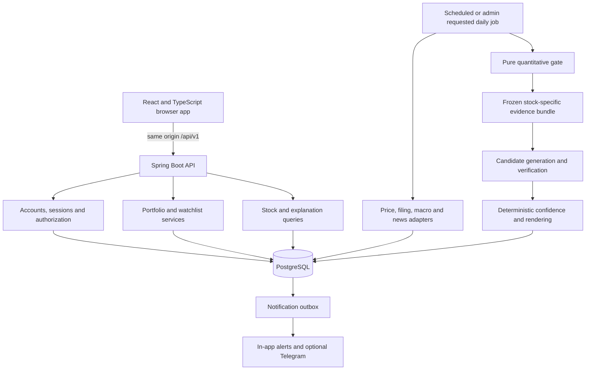

# MoneyFest full-stack completion plan

Prepared 1 October 2026. Status: proposed architecture and implementation roadmap;
the first Java account/portfolio milestone is now implemented; engine migration remains.
Existing product invariants in DESIGN.md
remain binding. This plan supersedes neither financial-domain decisions nor evidence curation.

## Product

MoneyFest is an end-of-day portfolio companion for NSE/BSE investors. It answers:
what do I own, how did its value change, and what supported evidence may explain a
significant stock move? Routine market movement and no clear driver remain valid answers.
It does not predict prices, recommend trades, or invent impact percentages.

Primary journey: create an account -> add holdings or a watchlist -> see dated valuation
and allocation -> open a stock -> inspect its assessment, candidate drivers and citations
-> configure alerts. Administrators inspect failed jobs and curate exposure profiles.

## Verified starting point

This inventory describes the pre-migration baseline. See docs/DEVELOPMENT.md for the
implemented Java milestone, startup commands and remaining scope. Account sessions,
owned holdings, watchlists and preferences now use Java/PostgreSQL; the browser is
connected to that backend. The chart hook/lint defects below have been fixed.

| Area | Repository evidence | Completion work |
|---|---|---|
| Frontend | React, TypeScript, Vite, Tailwind; four routes in frontend/src/pages | Retain and complete; Java serves the API, TypeScript serves browser interactions |
| Backend | FastAPI in app/api.py; ingestion, gate, attribution and portfolio modules | Migrate deliberately to Spring Boot with parity checks |
| Persistence | SQLite schema and additive migrations in app/db | PostgreSQL, versioned migrations and ownership constraints |
| Authentication | Landing form only navigates; shared WEB_TOKEN backend gate | Individual accounts, sessions, authorization and logout |
| Portfolio | API can update/remove holdings; UI displays positions | Add/edit/remove forms and persistent user ownership |
| History | Today's quantities applied to historical closes | Keep that label; add dated transactions before claiming historical performance |
| Explanations | Attribution endpoint and driver types exist | StockPanel only requests prices and displays generic outcome text; connect actual explanations and citations |
| Settings | Alert controls use component state | Fetch/save server preferences and show save failures |
| Stock discovery | Home filters already tracked stocks | Catalog lookup, watchlist management and stock detail navigation |
| Operations | EOD jobs, run logs and alert code exist | Durable job state, retries, source health and operational UI |
| Validation | Local offline run: 140 passed, 1 deselected, 1 expected failure | Preserve fixtures and port domain tests; live model acceptance remains unverified |

No market database ships in the clone. Historic row counts in HANDOFF.md describe a
previous environment, not this checkout. Offline tests do not establish live feed quality,
LLM accuracy, delivery reliability, or production readiness.

Frontend baseline: npm install and npm run build succeeded. npm run lint failed on
a conditional useMemo in frontend/src/components/charts/LineChart.tsx:72; Shell.tsx
also has a Fast Refresh export warning. Fix the hook ordering in the first frontend
slice and verify rendering as chart data changes from empty to populated.

## Target architecture

Use one Spring Boot application organized by feature, one React frontend, and one
PostgreSQL database. Scheduled workers initially run within the application with a
database lease so multiple instances cannot execute the same stock-day concurrently.



Proposed stack: Java 21 target, a supported stable Spring Boot release pinned when
scaffolding, Maven Wrapper, Spring Security, Bean Validation, Spring Data JPA for
transactional CRUD, explicit queries for analytics, Flyway, PostgreSQL, and Actuator.
Keep React/TypeScript/Vite/Tailwind. Use OpenAPI to describe the API and generate or
validate browser DTOs. Add a query cache if needed for mutations and invalidation.

Java 24, Maven 3.9.12, Node 24 and Python 3.14 are installed locally. Compile Java to
the selected target and verify the build/runtime combination. Container availability
and a PostgreSQL instance have not yet been checked.

References: [Spring Boot requirements](https://docs.spring.io/spring-boot/system-requirements.html)
and [PostgreSQL numeric types](https://www.postgresql.org/docs/current/datatype-numeric.html).
Use BigDecimal and NUMERIC for quantities, prices, money and fees; reject non-finite
inputs. Floating-point statistics remain appropriate within the gate with explicit tolerances.

## Backend modules and responsibilities

| Module | Responsibilities | Main persistence |
|---|---|---|
| identity | Registration, password hashing, sessions, current user, role checks | app_user, session |
| catalog | Tickers, verified exchange identifiers, sector lookup | stock, sector |
| watchlist | Per-user tracked stocks, add/remove | watchlist_item |
| portfolio | Position entry, valuation, allocation, dated transactions | portfolio, position, portfolio_transaction |
| marketdata | Adjusted closes, corporate actions, macro observations, source freshness | price_bar, factor_observation, source_run |
| evidence | Normalize, deduplicate, timestamp and tag source material | evidence, evidence_stock |
| exposure | Versioned templates, company overrides, human review | factor, sector_template, exposure_revision |
| assessment | Pure gate, frozen inputs/bundles, verified drivers, confidence | daily_metric, attribution, driver |
| notifications | Preferences, alert selection, outbox, delivery attempts | user_preferences, notification, delivery_attempt |
| operations | Job leases, run state, audit log, metrics | job_run, job_lease, audit_event |

Browser identity always comes from the authenticated session. Never accept a client
user_id as authority for portfolios, preferences, watchlists or alerts. Market facts
may be shared across users; personal state must be isolated by owner. Administration
requires an explicit ADMIN role and records curation changes in an audit log.

Use secure HttpOnly session cookies in production, SameSite policy, CSRF protection
for mutations, password hashing through Spring Security, session expiry and rotation,
login throttling, and strict production configuration. Persist sessions so restart does
not silently invalidate or resurrect access. Development fixtures are an explicit profile.

## Data model and accounting rules

- app_user owns portfolios, watchlists, preferences and notifications.
- portfolio owns positions and transactions; positions reference shared stocks.
- stock owns dated price bars and assessments; evidence is linked through evidence_stock.
- effective exposure = sector template plus ratified company overrides; drafts stay excluded.
- attribution references an immutable bundle, config/model/profile versions and verification log.
- driver links to evidence through explicit references; never accept arbitrary evidence IDs.
- source_run records success, partial failure, last complete coverage and freshness.
- notification is unique per recipient, assessment and channel. Retry records are separate.

Enforce unique stock/date/provider price bars, valid owner references, non-negative
position quantities/costs and indexed owner/date queries. Store timestamps in UTC and
derive trading days using Asia/Kolkata and a verified exchange calendar.

Valuation must use a coherent requested trading date, report missing/stale prices, and
exclude unpriced positions visibly. Store the corporate-action adjustment convention.
Imported opening positions are dated opening balances, not invented trades. Later
transactions can support historical position reconstruction and realized P&L with an
explicit accounting policy (weighted average proposed). Adjust splits consistently;
dividends and cash flows must be included before labelling a chart total return.

## API and frontend map

All new routes use /api/v1. Define request validation, bounded pagination, ISO dates,
decimal serialization, ProblemDetail errors and request IDs in the contract. Browser
code must not compute authoritative balances or assign explanation confidence.

| Screen or action | Proposed API | Service |
|---|---|---|
| Register/login/logout/current user | POST /auth/register, /auth/login, /auth/logout; GET /auth/me | identity |
| Stock search and overview | GET /stocks?query=&page= | catalog, marketdata |
| Stock detail and price chart | GET /stocks/{id}; GET /stocks/{id}/prices?from=&to= | marketdata |
| Why it moved and cited drivers | GET /stocks/{id}/assessment?date= | assessment, evidence |
| Watchlist management | GET/POST /me/watchlist; DELETE /me/watchlist/{stockId} | watchlist |
| Portfolio totals and positions | GET /me/portfolio | portfolio |
| Add/edit/remove positions | PUT/DELETE /me/portfolio/positions/{stockId} | portfolio |
| Allocation and valuation history | GET /me/portfolio/allocation, /me/portfolio/history | portfolio |
| Dated transaction entry | GET/POST /me/portfolio/transactions | portfolio |
| Transaction corrections | PATCH /me/portfolio/transactions/{id} with revision check | portfolio |
| Saved settings | GET/PATCH /me/preferences | notifications |
| Alert inbox | GET /me/notifications; PATCH /me/notifications/{id} | notifications |
| Admin job control | GET/POST /admin/jobs; GET /admin/jobs/{id} | operations |
| Exposure review | GET /admin/exposures; POST /admin/exposures/{id}/ratify or /reject | exposure |

Assessment response includes date, freshness, gate outcome, processing state, rendered
explanation, ranked drivers, confidence reasons and cited evidence metadata/links.
Pending processing, no clear driver, source failure and no stored assessment are distinct.
Do not expose raw internal bundles, prompts or operational endpoints to regular users.

Frontend retains its existing palette, light/dark themes and charts. Complete landing
with real auth; add guarded routes and logout. Dashboard gets holding forms and clear
empty states. Stock details become accessible from both Home and portfolio and show
the actual assessment. Settings save preferences and handle failures. Add an alert
inbox and role-protected operations pages. All forms need validation, pending states,
keyboard navigation, responsive layouts and actionable errors. Modal focus must be managed.

## Engine migration and external dependencies

1. Freeze Python fixtures for calendar alignment, gate outcomes, portfolio arithmetic,
   profile merging, bundle filtering, confidence scoring and rendering.
2. Port the pure functions to Java and compare results with those fixtures. Statistical
   values use documented tolerances; categorical results and filtering must match exactly.
3. Port source adapters behind interfaces. yfinance is a Python dependency, so its
   functionality requires an explicit Java data adapter rather than an assumed package swap.
4. During migration only, a private Python worker may bridge data acquisition. It must
   not be browser-facing or bypass Java ownership rules. Remove it before declaring an
   all-Java backend complete; preserve the Python implementation as a test reference.
5. Port attribution through a provider abstraction with structured output, request
   budgets, bounded retries and persisted failures. Retain exactly two model calls for
   the attribution path; deterministic filtering and confidence stay outside the models.

Preserve the aligned stock/index calendar, versioned gate thresholds, stock-specific
factor direction, curated profiles, cited claims and honest NO_DRIVER outcomes. Carry
numeric signed macro moves into the evidence/bundle schema to resolve the existing xfail.
Treat EVENT_NO_MOVE as its own product path and preserve the existing engine contract.

Live market access needs a provider with suitable historical coverage and permission
for the intended deployment. Confirm licensing, rate limits, exchange calendar and
corporate-action semantics before relying on a public feed. A demo profile uses labelled
offline fixtures; it never pretends sample prices or explanations are live.

An LLM key is needed for live candidate/verifier evaluation. Telegram credentials are
needed only for that delivery channel. No paid provider calls or public deployment are
part of this planning pass. Do not substitute synthetic output for validated explanations.

## Implementation sequence and acceptance gates

| Phase | Deliverable | Exit criteria |
|---|---|---|
| 1. Foundation | backend Maven project, PostgreSQL migrations, health, local scripts, environment example, API contract | Fresh database boots; migrations repeat safely; documented local startup works |
| 2. First complete user journey | Real accounts, owned portfolio, holding CRUD, stock lookup, React integration | Two users cannot access each other's state; holdings persist after restart; empty/missing-price states work |
| 3. Portfolio completeness | Watchlists, allocation, dated opening balances and transaction ledger, settings | Totals reconcile; historical semantics are accurate; settings persist; mutations refresh views |
| 4. Explanation engine | Java gate, evidence, exposures, numeric macro direction, citations in UI | Python fixture parity; draft leakage and unrelated evidence rejected; sources/freshness visible |
| 5. Live processing | Source adapters, exchange calendar, durable EOD jobs, live model validation, alert inbox, optional Telegram | Runs are idempotent; outage/quota failures visible; reruns avoid duplicate alerts; model acceptance clears |
| 6. Release readiness | Admin curation/ops, browser tests, CI, production container configuration, backup/restore and runbook | Fresh install and restore verified; supported browsers work; production configuration fails closed |

Implement in vertical slices: database -> Java service -> API -> frontend -> behavior
checks. Finish each slice before expanding. Phase 2 should already yield a usable
full-stack account/portfolio app. Phases 4-5 deliver MoneyFest's explanation promise.
No deadline estimate is defensible until data-provider access and migration parity are known.

## Validation and definition of complete

- Java unit tests for calculations and gate/profile/bundle invariants; existing Python
  cases become cross-language regression fixtures.
- PostgreSQL integration tests for migrations, ownership, transaction corrections,
  job leases and notification uniqueness; use Testcontainers where Docker is available.
- API security checks for unauthenticated access, CSRF, ownership and admin permissions.
- Browser scenarios: register, log in, add/edit/remove a holding, view missing prices,
  open cited assessment, save/reload settings, log out and verify user isolation.
- Adapter contract tests cover incomplete feeds, timeouts, throttling and corporate actions.
- Live golden evaluation: follow HANDOFF.md's >=60% top-driver hit rate and 10/10
  NO_DRIVER honesty target; record and ship the validated model/version. Offline tests
  remain independent of provider quotas.
- CI runs Java tests, frontend type/build/lint checks and meaningful browser tests.

Completion means the documented user journey works against persistent Java-backed
storage, both user and administrator access are enforced, daily assessments display
real citations and dates, failures are observable, and a fresh checkout can be started
and verified. External integrations remain explicitly disabled until configured and
validated. A successful build alone does not establish those properties.

## Proposed repository layout

```text
backend/
  pom.xml, mvnw, mvnw.cmd
  src/main/java/.../{identity,catalog,watchlist,portfolio,marketdata,evidence,
                    exposure,assessment,notifications,operations,config}
  src/main/resources/{application.yml,db/migration/}
  src/test/
frontend/                 existing React app, completed feature by feature
docs/                     API contract, data conventions, setup and runbook
scripts/                  local startup, seed and migration helpers
compose.yaml              PostgreSQL and release services
.env.example              placeholders and documented settings
.github/workflows/        checks
app/, tests/, data/       preserved Python reference and curated assets during migration
```

Current milestone: the Java account-to-portfolio journey, watchlists and saved preferences
are implemented and verified. Next implementation work is the transaction model and the
deterministic engine/data migration, followed by live attribution validation. Complete the
remaining API-contract and release tooling alongside those slices. Replace the legacy
engine runtime only after its migration acceptance gates pass.
